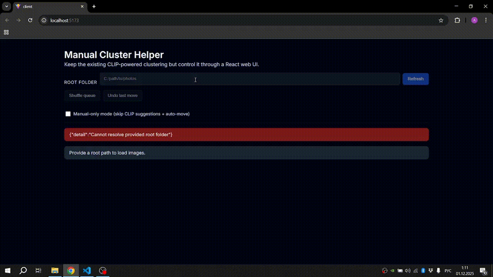

# Cluster Forge — React client

This is the Vite/React (JSX) frontend for [Cluster Forge](../README.md), a local, human-in-the-loop photo organization tool.



[Recorded UI demo (MP4)](../assets/cluster-preview.mp4) · [Optimized animated GIF](../assets/cluster-preview-small.gif)

The UI sends queue, assign, skip, shuffle, undo and auto-move requests to the local FastAPI backend. Classification suggestions use CLIP image embeddings compared against centroids from human-labeled examples; they are not independently measured accuracy percentages.

## Run locally

1. Start the backend **from the repository root**:

   ```powershell
   python -m pip install -r backend/requirements.txt
   $env:CLUSTER_FORGE_WORKSPACE = "C:\\path\\to\\disposable-photo-copies"
   $env:CLUSTER_FORGE_ORIGIN = "http://localhost:5173"
   python -m uvicorn api:app --host 127.0.0.1 --port 8000
   ```

   The workspace must already exist, and all image folders you select in the UI must be inside it. Always work on **copies** of images when trying automatic file moves.

2. Start the React interface in another terminal:

   ```powershell
   cd client
   Copy-Item .env.example .env
   npm ci
   npm run dev
   ```

3. Open `http://localhost:5173`. The client uses `VITE_API_BASE=http://localhost:8000` by default (see `.env.example`). Choose a folder within `CLUSTER_FORGE_WORKSPACE`.

The frontend includes a manual-only toggle. **Manual-only** skips CLIP embeddings and auto suggestions; to collect labeled CLIP examples for similarity-based suggestions, label images with manual-only turned **off**.

## Code layout

- `src/App.jsx`: UI state, queue controls and API requests.
- `src/App.css`: interface styles.
- `src/main.jsx`: frontend entry point.
- `../backend/api.py`: API routes and workspace validation.
- `../backend/cluster_core.py`: embeddings, centroids, moves and history.

## Demonstration scope

The GIF demonstrates user-interface interactions, not a measured percentage of time saved. A model similarity threshold is not an observed classification accuracy. This project is a local tool with filesystem access; it is **not** designed to expose the backend on the public internet.

For implementation notes and the relationship with Photo Report Generator, see the [root README](../README.md).
